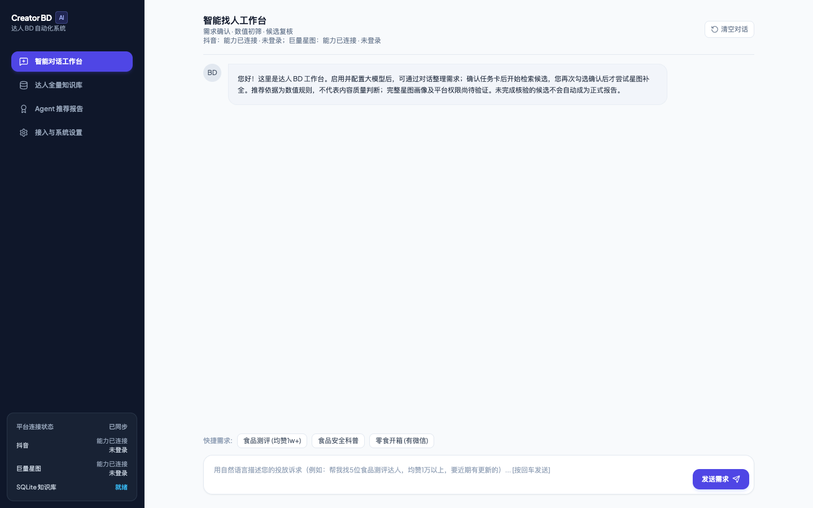

# 达人 BD 工作台

面向投放商务的本地工作台。从自然语言需求出发，按条件查找达人，人工复核候选，补全授权可见的星图数据，最后导出 Excel。

**业务流程：** 需求确认 → 巨量星图检索 → 候选复核 → 授权补全 → 推荐报告 → Excel



## 能做什么

| 环节 | 功能 |
| --- | --- |
| 智能对话 | 连接兼容 Chat Completions 的模型，把需求整理成待确认的检索条件；人工确认后才开始检索。 |
| 达人检索 | 新任务以巨量星图为主；按粉丝数、近期点赞和内容方向初筛，显示候选、待核实、不符合及受阻状态。 |
| 账号管理 | 抖音与巨量星图分开管理登录。支持人工登录、验证和切换账号；安全验证、登录失效或权限不足时停止相关步骤。 |
| 数据补全 | 人工勾选后再补全。仅处理当前账号有权查看的播放数据、受众分布、报价及商务联系方式；缺失数据不猜测。 |
| 知识库与报告 | SQLite 保存达人主档和候选记录；核验通过的资料进入任务报告，支持筛选及 Excel 导出。 |

巨量星图检索在工作台内接入，不要求另装一个同名 CLI。仓库包含[抖音 CLI 源码](tools/douyin-cli-poc/README.md)，它是单独安装的集成，不是新任务默认的找人来源。

## 启动

使用 Python 3.12。在项目根目录执行以下命令。

**macOS / Linux**

```bash
python3.12 -m venv .venv
.venv/bin/python -m pip install -r requirements.txt
.venv/bin/python -m app.main
```

**Windows PowerShell**

```powershell
py -3.12 -m venv .venv
.\.venv\Scripts\python.exe -m pip install -r requirements.txt
.\.venv\Scripts\python.exe -m app.main
```

打开 [127.0.0.1:8088](http://127.0.0.1:8088)。端口已被占用时，可使用 `python -m uvicorn app.main:app --host 127.0.0.1 --port 8089`，请使用当前虚拟环境中的 Python。

## 接入真实业务

1. **模型：** 在「接入与系统设置」填写自己的 Base URL、模型名和 API Key，测试连接后启用。未经连接的工作台不会假装返回模型结果。
2. **浏览器：** 如需使用平台登录，先在同一个项目根目录安装 Chromium。项目默认从下面指定的位置加载浏览器：

   ```bash
   PLAYWRIGHT_BROWSERS_PATH="$PWD/tools/douyin-cli-poc/.browsers" .venv/bin/python -m playwright install chromium
   ```

   ```powershell
   $env:PLAYWRIGHT_BROWSERS_PATH = Join-Path (Get-Location) 'tools\douyin-cli-poc\.browsers'
   .\.venv\Scripts\python.exe -m playwright install chromium
   ```

3. **平台账号：** 在工作台的「平台认证与登录态管理」使用自己的授权账号完成登录。需要验证码时，在平台窗口人工验证。换号不增加权限，也不用于绕过验证。
4. **执行与交付：** 在对话中描述目标，检查任务卡后再启动。选择候选并完成补全，在「推荐报告」导出核验结果；没有可导出的报告时检查候选状态和缺失字段。

## 本地数据与验证

- `data/` 保存 SQLite 数据库（包括本地设置），`exports/` 保存导出表。可在启动前设置 `CREATOR_BD_HOME`，把这两个目录迁到另一个可写位置。此设置不会复制旧数据或迁移平台登录态。
- 仅在自己信任的设备上运行，保持监听在 `127.0.0.1`；工作台不是面向公网的多用户服务。不要提交 API Key、登录态、真实达人数据和导出表。
- 本地回归：使用虚拟环境中的 Python 执行 `python -m unittest discover -s tests -v`。真实检索和补全是否可用仍取决于账号授权、平台状态和当前页面。
